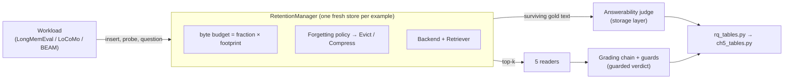

# forget-it


**A harness for measuring forgetting policies in byte-bounded agent memory.**

An agent with persistent memory eventually runs out of room and has to decide what to drop. `forget-it` models that memory as a byte-bounded store. Any forgetting policy can be plugged in, from LRU to LLM summarisation to forgetting curves. Each resulting memory store is then measured twice on the same scored questions:

1. **At the storage layer.** An LLM judge reads only the text that survived and says whether the question can still be answered from it (*answerability*).
2. **End to end.** A retriever picks the top-k items, five reader LLMs answer from them, and a grading chain produces the *guarded verdict*.

The thesis asks whether choosing a policy by answerability gives the same choice as choosing it by answer accuracy, and how many accuracy points a wrong choice costs.

---

## Contents

- [Quickstart (local, no GPU)](#quickstart-local-no-gpu)
- [Reproducing the thesis](#reproducing-the-thesis)
- [The experimental grid](#the-experimental-grid)
- [How it works](#how-it-works)
- [Outputs and metrics](#outputs-and-metrics)
- [Extending the framework](#extending-the-framework)
- [Known limitations](#known-limitations)
- [License and citation](#license-and-citation)

---

## Quickstart (local, no GPU)

Requires **Python 3.12+**.

```bash
git clone https://github.com/Str3am786/forget-it
cd forget-it
python -m venv .venv && source .venv/bin/activate
pip install -e ".[dev]"

python -m pytest tests -q                  # ~540 tests, ~15 s
python -m forgetit.experiments.run_toy     # 5 inserts into a 250-byte store
```

### Demo: forgetting on LongMemEval (about 20 seconds, no LLM)

```bash
mkdir -p data
wget -P data/ https://huggingface.co/datasets/xiaowu0162/longmemeval-cleaned/resolve/main/longmemeval_s_cleaned.json

python -m forgetit.experiments.run_longmemeval_qa \
    --no-reader --limit 3 \
    --policies lru lfu fifo oracle \
    --retrievers bm25 \
    --budgets 1.0 0.25 \
    --gold-snapshot \
    --out-dir artifacts/demo
```

This replays 3 examples under 4 policies × 2 budgets × 2 itemisers. It prints one line per memory store:

```
itemiser=turn_pair  store=retention/lru/bm25/budget_100pct  reader=none  gold_survival=1.000 hit@k=1.000
itemiser=turn_pair  store=retention/lru/bm25/budget_025pct  reader=none  gold_survival=0.333 hit@k=0.333
itemiser=turn_pair  store=retention/oracle/bm25/budget_025pct  reader=none  gold_survival=1.000 hit@k=1.000
...
```

At 100% nothing is evicted, so every policy is at the ceiling. At 25% the policies diverge, and `oracle`, which is told the gold items, stays at the ceiling. Results land in `artifacts/demo/longmemeval/<itemiser>/retention/<policy>/<retriever>/<budget>/none/`.

### Demo with a reader

Point the client at any OpenAI-compatible endpoint (Ollama, vLLM, OpenAI) and drop `--no-reader`:

```bash
export LLM_BASE_URL="http://localhost:11434/v1"
export LLM_API_KEY="anything-non-empty"
export LLM_MODEL="qwen2.5:7b-instruct"

python -m forgetit.experiments.run_longmemeval_qa \
    --limit 3 --policies lru oracle compression --retrievers bm25 --budgets 1.0 0.25
```

`compression` uses the same endpoint to summarise items. Add `--dense` for the embedding retriever (it needs `EMBED_BASE_URL` / `EMBED_MODEL`). `run_locomo_qa` and `run_beam` take the same flags and read `data/locomo10.json` and `data/beam_500K.jsonl`.

### Regenerate the Chapter 5 tables (offline, seconds)

The three frozen analysis bundles are committed under `report/rq_dated5_{lexical,bm25,dense}/`. Every Chapter 5 table is derived from them:

```bash
python scripts/ch5_tables.py --skip-heavy            # → report/ch5/*.csv + README.txt
```

`--skip-heavy` skips the two tables that stream the raw judged and store rows from LUMI scratch. The script refuses to write its provenance manifest from a dirty working tree. Commit first, or set `ALLOW_DIRTY=1` for a scratch run.

---

## Reproducing the thesis

The full campaign runs on LUMI-G (AMD MI250X) with vLLM in a ROCm container. One-time setup is described in [scripts/lumi/README.md](scripts/lumi/README.md): the client container, pre-downloaded weights, and data in `data/`. Every launcher reads its defaults from `scripts/lumi/env.sh`:

```bash
export SBATCH_ACCOUNT=project_<id>        # never commit this
source scripts/lumi/env.sh                # prints which paths exist
```

Then run the stages in order. Each stage reads the previous stage's output and writes a `manifest.json` that records its commit, model and prompt.

| # | Stage | Command | Writes |
|---|---|---|---|
| 1 | **State-forming sweep**: every policy × retriever × budget, no reader. Compression uses Qwen2.5-7B and dense uses Qwen3-Embedding-0.6B. | `for ds in longmemeval beam locomo; do DATASETS=$ds sbatch scripts/lumi/run_lumi_full_eval.sh; done` | `artifacts/benchmark_full/` (results, gold snapshots, retrieval dumps, event logs) |
| 2 | **Subsets**: symlinked views, one per retriever, over turn-pair itemisers, 5 budgets, 15 policies, 1 random seed | `for r in lexical bm25 dense; do bash scripts/lumi/build_subsets.sh --retriever $r; done` | `artifacts/sweep_subset_<retriever>/` |
| 3 | **Reader sweep**: 5 readers, each in its own array task, replaying the stored retrieval across 4 arms (retrieved / gold / empty / parametric) | `RUN_DIR=.../sweep_subset_bm25 OUT_DIR=.../reader_sweep_bm25 sbatch --array=0-4 scripts/lumi/run_lumi_reader_sweep.sh` | `<OUT_DIR>/<reader>/*.jsonl` |
| 4 | **Answer judge**: Qwen2.5-14B over the routed tiers | `SWEEP_ROOT=.../reader_sweep_bm25 OUT_DIR=.../judged5_bm25 sbatch scripts/lumi/run_lumi_answer_judge.sh` | `judged_<workload>_<reader>.csv` |
| 5 | **Answerability**: the same judge over the surviving gold text | `SUBSET_ROOT=.../sweep_subset_bm25 OUT_DIR=.../alive_dated_bm25 sbatch scripts/lumi/run_lumi_gold_alive.sh` | `store_<workload>.csv` |
| 6 | **Prespecified tests**: guarded verdict, monotonicity, wrong-pick cost, pairwise McNemar + BH, top sets | `JUDGED_DIR=.../judged5_bm25 ALIVE_DIR=.../alive_dated_bm25 python scripts/rq_tables.py --out report/rq_dated5_bm25` | `report/rq_dated5_<retriever>/` |
| 7 | **Chapter 5 tables** | `python scripts/ch5_tables.py` | `report/ch5/` |

Repeat stages 3–6 for each retriever (`lexical`, `bm25`, `dense`). `...` stands for `/scratch/$PROJ/artifacts`.

**Supporting passes**, each documented in its script header:
- `run_lumi_calibration.sh` scores the grading chain against hand labels in `corpora/grader/`.
- `run_preservation.sh` runs `gold_preservation.py` for deterministic containment.
- `eviction_regret.py` analyses survival and regret from `events.jsonl`.
- `replay_equivalence.py` checks that a replay is deterministic.

**Before a reader sweep**, run the sync gate at the top of `run_lumi_reader_sweep.sh`: pull, check that `render_sha` prints `98d35e968dcf`, and run the test suite. The tables assume that exact evidence renderer.

---

## The experimental grid

| Axis | Values |
|---|---|
| Workloads | LongMemEval (S, cleaned), LoCoMo-10, BEAM-500K |
| Itemiser | turn pair. Session, turn and batch itemisers also exist. |
| Budget fraction | 1.0 (no-eviction control), 0.75, 0.50, 0.25, 0.10 of each example's own footprint |
| Retriever | lexical overlap, BM25, dense (cosine) |
| Policies (15) | `fifo` `lru` `lfu` `random` `keep_smallest` `evict_smallest` `salience_decay` `gdsf` `gdsf_frozen` `semantic` `semantic_coverage` `semantic_keep` `ebbinghaus` `compression` `oracle` |
| Readers (5) | qwen2.5-1.5b / 7b / 14b-instruct, llama-3.1-8b-instruct, gemma-3-12b-it (`configs/readers.json`) |
| Judge | qwen2.5-14b-instruct, the same judge for answerability and for answers |

A **cell** is one workload × budget × retriever. The 1.0 control is excluded, which leaves 3 × 4 × 3 = 36 cells. Within a cell, memory stores differ only in their forgetting policy. `oracle` is told each example's gold items. It is a ceiling, not a candidate, and is excluded from deployable picks. The floor arms (`empty`, `parametric`) and the `gold` arm bound what any policy could achieve.

---

## How it works



**Memory as a byte-bounded store.** Each memory is a `MemRecord` with a byte cost. `RetentionManager.insert()` loops: *while over budget, ask the policy for an action and execute it*. The action is `Evict`, which deletes the item, or `Compress`, which rewrites the text shorter, re-embeds it and credits the bytes saved. A guard raises an error if an action frees nothing. Every decision is logged at the moment it is made, with the policy's score, the victim's features, the store occupancy and the decision latency. Scores are never reconstructed afterwards.

**Probes and scored questions.** During ingestion the workload issues access-only probes through `retrieve()`, which updates the recency and frequency signals that LRU, LFU, GDSF and Ebbinghaus read. Scored questions come after the final insert and use the read-only `search()`, so evaluation never changes policy state. `counter_state_hash()` is the check. On LoCoMo and BEAM, probes are drawn from a disjoint, stratified half of the questions (`benchmark/probe_split.py`). On LongMemEval, which has one question per example, a probe repeats the text of an item already in the store.

**Concurrency.** Each example replays on its own fresh store (`run_pipeline_concurrent`), so examples run in parallel without sharing state. Inside an example, every eviction stays serial. The reader is a second pass over the stored contexts.

```
src/forgetit/
├── core/            MemRecord, Query, byte-cost model, event logger, phase timer
├── memory_system/   MemorySystem protocol, RetentionManager, EmptyStore, Letta wrapper
├── policies/        baselines, density (GDSF, salience), semantic, ebbinghaus, oracle, llm_compression
├── backend/         Backend ABC, InMemoryBackend (all experiments), FalkorBackend (partial)
├── retrieval/       lexical overlap, BM25, embedding
├── embeddings/      OpenAI-compatible embedder + sqlite cache
├── llm/             OpenAI-compatible client, disk cache, readers (PlainTextReader, prompt templates)
├── benchmark/       workloads, runner_core, pipeline, metrics, grading, probe_split, budget
└── experiments/     run_longmemeval_qa, run_locomo_qa, run_beam (+ toy, synthetic, stress)
scripts/             analysis passes (gold_alive, judge_reader_answers, rq_tables, ch5_tables, …)
scripts/lumi/        SLURM launchers for every stage above
configs/ prompts/ corpora/   reader roster, prompt templates, calibration and judge corpora
report/              committed analysis bundles (rq_dated5_*) and Chapter 5 tables
```

---

## Outputs and metrics

Each configuration writes to `<out_dir>/<dataset>/<itemiser>/<store_label>/<reader>/`:

| File | Contents |
|---|---|
| `results.csv` | One `EvalResult` row per scored question, with provenance columns (`git_commit`, `config_hash`, prompt SHAs) |
| `summary.csv`, `summary_by_qtype.csv` | Aggregates from `metrics.summarize()` |
| `timings.json` | Time per phase (insert, evict_select, evict_exec, retrieve, …) |
| `gold_answer_snapshot.jsonl` | Original vs. surviving text of every gold item (`--gold-snapshot`) |
| `retrieved_index.jsonl` | Ranked retrieval per question, which the reader sweep replays (`--dump-retrieval`) |
| `events.jsonl` | Every insert, evict, compress and decision (`--event-log`) |

Headline measures:
- **Storage layer**
  - `gold_id_retained`: did a gold item survive.
  - `answerable_store`: the judge's verdict on the surviving text (`gold_alive.py`).
  - `useful_byte_fraction`: the share of resident bytes that is gold.
- **Retrieval**
  - `gold_ranks`: ranks at full depth, from which hit@k, nDCG@k, recall@k and MRR are recomputed offline.
  - `hit_at_k_given_retained`: hit@k counted only where the gold item survived.
  - `query_coverage`: how close the nearest surviving item is to the question.
- **Answer**
  - `qa_correct` / `qa_f1`: deterministic grades.
  - Guarded verdict (`rq_tables.py`): string rules first, then the judge on routed tiers. Two guards demote answers that miss a contradiction (G1) or abstain (G2).

Stores that don't expose their contents (Letta, EmptyStore) set `introspectable=False`. For them, the storage-layer columns are placeholder values.

---

## Extending the framework

**A delete-only policy** implements `select_victim`. It reads `MemFeatures`, not text, and must record its score:

```python
from forgetit.policies.base import SimpleEvictionPolicy

class MyPolicy(SimpleEvictionPolicy):
    name = "my_policy"

    def select_victim(self, store, candidates=None) -> str:
        feats = [f for f in store.iter_features()
                 if candidates is None or f.id in candidates]
        victim = min(feats, key=lambda f: f.access_count)
        self._note_decision(victim.access_count, len(feats))
        return victim.id
```

Stateful policies can also define `on_insert`, `on_access` and `on_evict`, as GDSF does. A policy that compresses implements `select_action` and returns `Compress(id, new_text)` (see `llm_compression.py`). Register the policy in `default_policy_specs` in each entry point, and then `--policies my_policy` selects it.

**A new dataset** needs a workload with `iter_examples()` that yields `(example_id, [WorkloadEvent])`: inserts, access-only probes (`gold_item_ids=[]`) and scored questions. It also needs an `Itemiser`. `workloads/synthetic.py` is the smallest example and `workloads/locomo.py` the most complete.

---

## Known limitations

- `FalkorBackend` is only partially implemented, and `Prune` raises `NotImplementedError`. Every experiment uses `InMemoryBackend`.
- **Ebbinghaus** measures decay from `created_at`, not from the last recall. Recall increases strength but doesn't reset the clock.
- **Compression** has to fit its prompt in the model's context (`--compress-context-tokens`). Larger items fall back to the evict selector, and the decision log records that.
- **The judge is also a reader.** The 14B judge grades its own answers on one fifth of rows. The effect is the same across policies, and the methods chapter declares it.
- LoCoMo adversarial questions with no gradeable reference are excluded (`configs/locomo_ungradeable_ids.txt`).

---

## License and citation

*TODO: add a license file.*

```bibtex
@mastersthesis{forgetit2026,
  title  = {Policy-Pluggable Forgetting for Local Agentic Memory under Hard Storage Constraints},
  author = {Miguel Arroyo},
  school = {TODO},
  year   = {2026}
}
```
