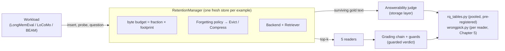

# forget-it


**A harness for measuring forgetting policies in byte-bounded agent memory.**

An agent with persistent memory eventually runs out of room and has to decide what to drop. `forget-it` models that memory as a byte-bounded store. Any forgetting policy can be plugged in, from LRU to LLM summarisation to forgetting curves. Each resulting memory store is then measured twice on the same scored questions:

1. **At the storage layer.** An LLM judge reads only the text that survived and says whether the question can still be answered from it (*answerability*).
2. **End to end.** A retriever picks the top-k items, five reader LLMs answer from them, and a grading chain produces the *guarded verdict*.

The thesis asks whether choosing a policy by answerability gives the same choice as choosing it by answer accuracy, and how many accuracy points a wrong choice costs.

---

## Contents

- [forget-it](#forget-it)
  - [Contents](#contents)
  - [Quickstart (local, no GPU)](#quickstart-local-no-gpu)
    - [Demo: forgetting on LongMemEval (about 20 seconds, no LLM)](#demo-forgetting-on-longmemeval-about-20-seconds-no-llm)
    - [Demo with a reader](#demo-with-a-reader)
    - [Recompute the Chapter 5 results (offline, minutes)](#recompute-the-chapter-5-results-offline-minutes)
  - [Reproducing the thesis](#reproducing-the-thesis)
  - [The experimental grid](#the-experimental-grid)
  - [How it works](#how-it-works)
  - [Outputs and metrics](#outputs-and-metrics)
    - [Configs and committed logs](#configs-and-committed-logs)
  - [Extending the framework](#extending-the-framework)
  - [Known limitations](#known-limitations)
  - [License and citation](#license-and-citation)

---

## Quickstart (local, no GPU)

Requires **Python 3.12+**.

```bash
git clone https://github.com/Str3am786/forget-it
cd forget-it
python -m venv .venv && source .venv/bin/activate
pip install -e ".[dev]"

python -m pytest tests -q                  # ~540 tests, ~15 s
python -m forgetit.experiments.run_toy     # 5 inserts into a 250-byte store
```

### Demo: forgetting on LongMemEval (about 20 seconds, no LLM)

```bash
mkdir -p data
wget -P data/ https://huggingface.co/datasets/xiaowu0162/longmemeval-cleaned/resolve/main/longmemeval_s_cleaned.json

python -m forgetit.experiments.run_longmemeval_qa \
    --no-reader --limit 3 \
    --policies lru lfu fifo oracle \
    --retrievers bm25 \
    --budgets 1.0 0.25 \
    --gold-snapshot \
    --out-dir artifacts/demo
```

This replays 3 examples under 4 policies × 2 budgets × 2 itemisers. It prints one line per memory store:

```
itemiser=turn_pair  store=retention/lru/bm25/budget_100pct  reader=none  gold_survival=1.000 hit@k=1.000
itemiser=turn_pair  store=retention/lru/bm25/budget_025pct  reader=none  gold_survival=0.333 hit@k=0.333
itemiser=turn_pair  store=retention/oracle/bm25/budget_025pct  reader=none  gold_survival=1.000 hit@k=1.000
...
```

At 100% nothing is evicted, so every policy is at the ceiling. At 25% the policies diverge, and `oracle`, which is told the gold items, stays at the ceiling. Results land in `artifacts/demo/longmemeval/<itemiser>/retention/<policy>/<retriever>/<budget>/none/`.

### Demo with a reader

Point the client at any OpenAI-compatible endpoint (Ollama, vLLM, OpenAI) and drop `--no-reader`:

```bash
export LLM_BASE_URL="http://localhost:11434/v1"
export LLM_API_KEY="anything-non-empty"
export LLM_MODEL="qwen2.5:7b-instruct"

python -m forgetit.experiments.run_longmemeval_qa \
    --limit 3 --policies lru oracle compression --retrievers bm25 --budgets 1.0 0.25
```

`compression` uses the same endpoint to summarise items. Add `--dense` for the embedding retriever (it needs `EMBED_BASE_URL` / `EMBED_MODEL`). `run_locomo_qa` and `run_beam` take the same flags and read `data/locomo10.json` and `data/beam_500K.jsonl`.

### Recompute the Chapter 5 results (offline, minutes)

This needs the judged and answerability files from stages 4 and 5 below, not a GPU. On a copy of the LUMI artifacts:

```bash
ART=/path/to/artifacts          # holds judged5_<retriever>/ and alive_dated_<retriever>/
python3 scripts/wrongpick.py selftest
python3 scripts/wrongpick.py run "$ART" report/thesis_checks/wrongpick
```

The committed outputs under `report/thesis_checks/wrongpick/` must come back byte for byte identical.

---

## Reproducing the thesis

The full campaign runs on LUMI-G (AMD MI250X) with vLLM in a ROCm container. One-time setup (client image, model weights, datasets) is in [scripts/lumi/README.md](scripts/lumi/README.md). In every command below, `A=/scratch/$PROJ/artifacts`, and `r` is one of `lexical bm25 dense`.

```bash
export SBATCH_ACCOUNT=project_<id>        # never commit this
source scripts/lumi/env.sh                # prints which paths exist
A=/scratch/$PROJ/artifacts
W="longmemeval_turn_pair beam_beam_turn_pair locomo_turn_pair"
```

Run the stages in order. Each stage reads the previous stage's output and writes a manifest that records its commit, model and settings.

| # | Stage | Command | Writes |
|---|---|---|---|
| 1 | **State-forming sweep.** Every policy × retriever × budget, no reader. Compression uses Qwen2.5-7B-Instruct and dense retrieval uses Qwen3-Embedding-0.6B. Ends by merging the shards (`concat_results.py`) and the offline regret pass (`eviction_regret.py`). | `for ds in longmemeval beam locomo; do DATASETS=$ds sbatch scripts/lumi/run_lumi_full_eval.sh; done` | `$A/benchmark_full/`: results, gold snapshots, retrieval dumps, event logs |
| 2 | **Subsets.** Symlinked views per retriever: turn-pair itemiser, 5 budgets, 15 policies, random seed 42. | `bash scripts/lumi/build_subsets.sh --retriever $r` | `$A/sweep_subset_<r>/<workload>/`, `SUBSET.json` |
| 3 | **Reader sweep.** 5 readers, one array task each, replaying the stored retrieval in 4 arms (retrieved, gold, empty, parametric). One job per workload. | `for w in $W; do RUN_DIR=$A/sweep_subset_$r/$w RETRIEVAL_DIR=$A/benchmark_full OUT_DIR=$A/reader_sweep_dated/$r/$w sbatch --array=0-4 scripts/lumi/run_lumi_reader_sweep.sh; done` | `$A/reader_sweep_dated/<r>/<workload>/<reader>/reader_*.jsonl` |
| 4 | **Answer judge.** Qwen2.5-14B-Instruct over the routed tiers (`miss`, `content_words`, `reverse`), prompt sha `cd216911a12f`. | `SWEEP_ROOT=$A/reader_sweep_dated/$r OUT_DIR=$A/judged5_$r sbatch scripts/lumi/run_lumi_answer_judge.sh` | `$A/judged5_<r>/judged_<workload>_<reader>.csv` |
| 5 | **Answerability.** The same judge over the surviving gold text. | `SUBSET_ROOT=$A/sweep_subset_$r OUT_DIR=$A/alive_dated_$r sbatch scripts/lumi/run_lumi_gold_alive.sh` | `$A/alive_dated_<r>/store_<workload>.csv` |
| 6 | **Pre-registered analysis.** Canonical merge, guarded verdict, monotonicity, wrong-pick cost, pairwise McNemar with Benjamini-Hochberg, top sets. Pools the five readers. | `JUDGED_DIR=$A/judged5_$r ALIVE_DIR=$A/alive_dated_$r python3 scripts/rq_tables.py --out report/thesis_checks/rq_pooled_$r` | `report/thesis_checks/rq_pooled_<r>/` |
| 7 | **Chapter 5 analysis.** Wrong-pick cost W(s) per reader and per setting, with bootstrap intervals, McNemar with BH, and the decision on H0. Its `POOLED` pseudo-reader must reproduce stage 6 exactly. | `python3 scripts/wrongpick.py run $A report/thesis_checks/wrongpick` | `report/thesis_checks/wrongpick/` |

Stages 2 to 6 repeat for each retriever. Stage 7 reads all three retrievers at once.

**Before a reader sweep**, run the sync gate at the top of `run_lumi_reader_sweep.sh`: pull, check that `render_sha` prints `98d35e968dcf`, and run the test suite. Every reader row assumes that exact evidence renderer.

**Why stage 3 runs per workload.** The sweep appends the reader id to `OUT_DIR`, and the judge in stage 4 reads `<workload>/<reader>/`. Setting `OUT_DIR` to `.../<r>/<workload>` gives that layout directly. In the reported campaign the three workload jobs of one retriever wrote one flat file per reader, which was then split by the `dataset` column and checked against the subsets. The note in each `run_manifest.<reader>.json` records this.

**Post hoc resident arm** (reader reads the surviving gold text directly, with no retriever). Same launchers, separate output folders so nothing appends to the main sweep:

```bash
for w in $W; do ARMS=resident RUN_DIR=$A/sweep_subset_$r/$w RETRIEVAL_DIR=$A/benchmark_full \
    OUT_DIR=$A/reader_sweep_resident/$r/$w sbatch --array=0-4 scripts/lumi/run_lumi_reader_sweep.sh; done
SWEEP_ROOT=$A/reader_sweep_resident/$r OUT_DIR=$A/judged_resident_$r sbatch scripts/lumi/run_lumi_answer_judge.sh
python3 scripts/check_resident_state.py ...  # snapshot integrity, see script header
python3 scripts/check_resident_run.py ...    # complete and duplicate-free output
python3 scripts/ch5_resident.py --artifacts $A
```

**Supporting passes**, each documented in its script header:

| Script | What it checks or produces |
|---|---|
| `scripts/lumi/run_lumi_calibration.sh` → `calibration_rescore.py` | Agreement of the grading chain with the hand labels in `corpora/grader/annotate.csv`, per instrument. Writes `report/ch5/t51_agreement.csv`. Measures the raw judge, before the guards. |
| `calibration_draw.py` | Draws the blind calibration sample for hand labelling. |
| `alive_labels.py` | Retest agreement of the answerability judge across two serving sessions, and the blind sufficiency label sample. |
| `check_floors.py` | Reference conditions (empty, parametric, gold) across the three retriever runs: whether movement comes from the judge, the reader or the retriever. Writes `report/thesis_checks/floors/`. |
| `ch5_tables.py` | Supporting Chapter 5 tables, including the gold ceiling by question category (`t51_ceiling_by_type.csv`, guarded). Set `ARTIFACTS_DIR` to run it off LUMI. |
| `ch5_fill.py` | Prints the figures the Chapter 5 text quotes, from the stage 7 outputs. Reads `~/thesis_checks/wrongpick` by default. |

---

## The experimental grid

| Axis | Values |
|---|---|
| Workloads | LongMemEval (S, cleaned), LoCoMo-10, BEAM-500K |
| Itemiser | turn pair. Session, turn and batch itemisers also exist. |
| Budget fraction | 1.0 (no-eviction control), 0.75, 0.50, 0.25, 0.10 of each example's own footprint |
| Retriever | lexical overlap, BM25, dense (cosine) |
| Policies (15) | `fifo` `lru` `lfu` `random` `keep_smallest` `evict_smallest` `salience_decay` `gdsf` `gdsf_frozen` `semantic` `semantic_coverage` `semantic_keep` `ebbinghaus` `compression` `oracle` |
| Readers (5) | qwen2.5-1.5b / 7b / 14b-instruct, llama-3.1-8b-instruct, gemma-3-12b-it (`configs/readers.json`) |
| Judge | qwen2.5-14b-instruct, the same judge for answerability and for answers |
| Primary reader | qwen2.5-7b-instruct. The other four are analysed separately, never pooled, in stage 7. |

A **setting** is one workload × budget × retriever. The 1.0 control is excluded, which leaves 3 × 4 × 3 = 36 settings. Within a setting, memory stores differ only in their forgetting policy. `oracle` is told each example's gold items. It is a ceiling, not a candidate, and is excluded from deployable picks. The reference arms (`empty`, `parametric`, `gold`) bound what any policy could achieve.

---

## How it works



**Memory as a byte-bounded store.** Each memory is a `MemRecord` with a byte cost. `RetentionManager.insert()` loops: *while over budget, ask the policy for an action and execute it*. The action is `Evict`, which deletes the item, or `Compress`, which rewrites the text shorter, re-embeds it and credits the bytes saved. A guard raises an error if an action frees nothing. Every decision is logged at the moment it is made, with the policy's score, the victim's features, the store occupancy and the decision latency. Scores are never reconstructed afterwards.

**Probes and scored questions.** During ingestion the workload issues access-only probes through `retrieve()`, which updates the recency and frequency signals that LRU, LFU, GDSF and Ebbinghaus read. Scored questions come after the final insert and use the read-only `search()`, so evaluation never changes policy state. `counter_state_hash()` is the check. On LoCoMo and BEAM, probes are drawn from a disjoint, stratified half of the questions (`benchmark/probe_split.py`). On LongMemEval, which has one question per example, a probe repeats the text of an item already in the store. `verify-r8-smoke.py` checks from a run's artefacts that no probe question was graded.

**Concurrency.** Each example replays on its own fresh store (`run_pipeline_concurrent`), so examples run in parallel without sharing state. Inside an example, every eviction stays serial. The reader is a second pass over the stored retrieval.

```
src/forgetit/
├── core/            MemRecord, Query, byte-cost model, event logger, phase timer
├── memory_system/   MemorySystem protocol, RetentionManager, EmptyStore, Letta wrapper
├── policies/        baselines, density (GDSF, salience), semantic, ebbinghaus, oracle, llm_compression
├── backend/         Backend ABC, InMemoryBackend (all experiments), FalkorBackend (partial)
├── retrieval/       lexical overlap, BM25, embedding
├── embeddings/      OpenAI-compatible embedder + sqlite cache
├── llm/             OpenAI-compatible client, disk cache, readers (PlainTextReader, prompt templates)
├── benchmark/       workloads, runner_core, pipeline, metrics, grading, probe_split, budget
└── experiments/     run_longmemeval_qa, run_locomo_qa, run_beam (+ toy, synthetic, stress)
scripts/             reader_probe, gold_alive, judge_reader_answers, rq_tables, wrongpick, checks
scripts/lumi/        SLURM launchers for every stage above
configs/ prompts/ corpora/   reader roster, prompt templates, calibration and judge corpora
report/              committed analysis bundles and the Chapter 5 outputs (thesis_checks/)
```

---

## Outputs and metrics

Each configuration writes to `<out_dir>/<dataset>/<itemiser>/<store_label>/<reader>/`:

| File | Contents |
|---|---|
| `results.csv` | One `EvalResult` row per scored question, with provenance columns (`git_commit`, `config_hash`, prompt SHAs) |
| `summary.csv`, `summary_by_qtype.csv` | Aggregates from `metrics.summarize()` |
| `timings.json` | Time per phase (insert, evict_select, evict_exec, retrieve, …) |
| `gold_answer_snapshot.jsonl` | Original vs. surviving text of every gold item (`--gold-snapshot`) |
| `retrieved_index.jsonl` | Ranked retrieval per question, which the reader sweep replays (`--dump-retrieval`) |
| `events.jsonl` | Every insert, evict, compress and decision (`--event-log`) |

Headline measures:
- **Storage layer**
  - `gold_id_retained`: did a gold item survive.
  - `answerable_store`: the judge's verdict on the surviving text (`gold_alive.py`).
  - `useful_byte_fraction`: the share of resident bytes that is gold.
- **Retrieval**
  - `gold_ranks`: ranks at full depth, from which hit@k, nDCG@k, recall@k and MRR are recomputed offline.
  - `hit_at_k_given_retained`: hit@k counted only where the gold item survived.
  - `query_coverage`: how close the nearest surviving item is to the question.
- **Answer**
  - `qa_correct` / `qa_f1`: deterministic grades.
  - Guarded verdict (`rq_tables.py`, copied verbatim into `wrongpick.py` and `ch5_tables.py`): string rules first, then the judge on routed tiers where it gave a verdict. Two guards then demote any correct verdict that misses a contradiction (G1) or abstains (G2).
- **Decision (Chapter 5)**
  - W(s): accuracy of the policy chosen by accuracy minus accuracy of the policy chosen by answerability, in one setting. A setting rejects H0 when W(s) is at least δ = 0.03 and the McNemar test between the two picks rejects after BH correction.

Stores that don't expose their contents (Letta, EmptyStore) set `introspectable=False`. For them, the storage-layer columns are placeholder values.

### Configs and committed logs

| File | Role |
|---|---|
| `configs/readers.json` | Hand-edited list of the five readers and their settings. `scripts/lumi/fetch_readers.py --manifest configs/readers.json` downloads them. |
| `configs/readers.lock.json` | Written by `fetch_readers.py` after staging: exact revisions, status, serving window, `chars_per_token`. `readers.json` says what was intended; the lock says what actually ran. The SLURM launchers check it before they start a reader or the judge. |
| `configs/locomo_ungradeable_ids.txt` | Frozen list of LoCoMo adversarial questions with no usable reference answer. `rq_tables.py` and `wrongpick.py` leave these out of accuracy, which takes LoCoMo from 1,388 scored questions to 1,075 graded ones. Changing it changes every LoCoMo denominator. |
| `logs/rq_tables_final.txt`, `logs/contradictions_final.txt` | Console output of `rq_tables.py` on the frozen evidence base (Qwen2.5-14B judge, 80,280 store rows). |

---

## Extending the framework

**A delete-only policy** implements `select_victim`. It reads `MemFeatures`, not text, and must record its score:

```python
from forgetit.policies.base import SimpleEvictionPolicy

class MyPolicy(SimpleEvictionPolicy):
    name = "my_policy"

    def select_victim(self, store, candidates=None) -> str:
        feats = [f for f in store.iter_features()
                 if candidates is None or f.id in candidates]
        victim = min(feats, key=lambda f: f.access_count)
        self._note_decision(victim.access_count, len(feats))
        return victim.id
```

Stateful policies can also define `on_insert`, `on_access` and `on_evict`, as GDSF does. A policy that compresses implements `select_action` and returns `Compress(id, new_text)` (see `llm_compression.py`). Register the policy in `default_policy_specs` in each entry point, and then `--policies my_policy` selects it.

**A new dataset** needs a workload with `iter_examples()` that yields `(example_id, [WorkloadEvent])`: inserts, access-only probes (`gold_item_ids=[]`) and scored questions. It also needs an `Itemiser`. `workloads/synthetic.py` is the smallest example and `workloads/locomo.py` the most complete.

---

## Known limitations

- `FalkorBackend` is only partially implemented, and `Prune` raises `NotImplementedError`. Every experiment uses `InMemoryBackend`.
- **Ebbinghaus** measures decay from `created_at`, not from the last recall. Recall increases strength but doesn't reset the clock.
- **Compression** has to fit its prompt in the model's context (`--compress-context-tokens 32000`). Items too large for it are not compressed, and the decision log records the outcome for each one.
- **The judge is also a reader.** The 14B judge grades its own answers on one fifth of rows. The effect is the same across policies, and the methods chapter declares it.
- **Dense retrieval is not exactly repeatable.** Embeddings computed on a GPU differ slightly between runs, so at the 100% budget the policies' accuracies under dense retrieval differ by up to 0.014. Under overlap and BM25 they differ by at most 0.001.
- **Stage 1 container.** `run_lumi_full_eval.sh` serves from the `lumi-multitorch-latest.sif` symlink, not a pinned release. The later stages pin `lumi-multitorch-u24r70f21m50t210-20260807_115122`.
- LoCoMo adversarial questions with no gradeable reference are excluded (`configs/locomo_ungradeable_ids.txt`). LongMemEval keeps its 30 abstention questions; `wrongpick.py run_noabs` is the sensitivity run without them.

---

## License and citation

Code under the [MIT License](LICENSE). The datasets keep their own licences and are not included.

```bibtex
@mastersthesis{forgetit2026,
  title  = {Irreversible Forgetting under Hard Storage Budgets},
  author = {Miguel Arroyo},
  school = {Aalto University},
  year   = {2026}
}
```